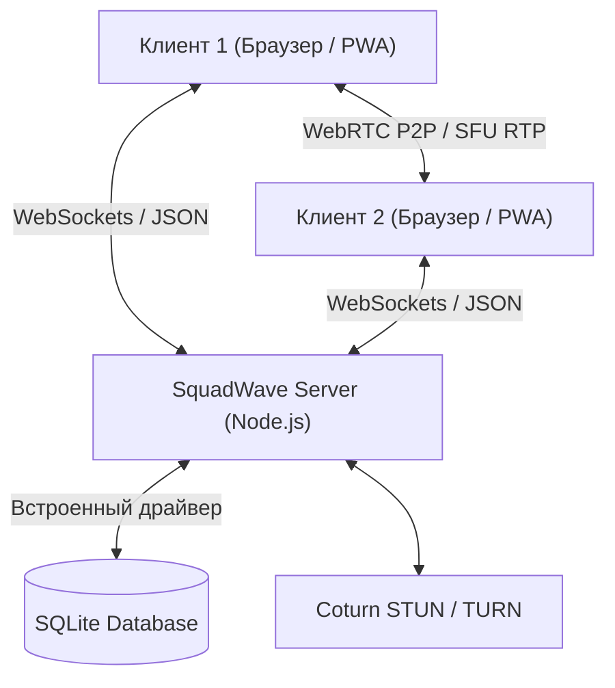

# ⚡ SquadWave

> **Полноценный Self-Hosted аналог Discord без Electron, блокировок и подписок**  
> *Реальная авторизация на SQLite • WebSockets • WebRTC голос и 1080p 60 FPS стрим экрана • RNNoise Wasm шумодав • PWA*

[](https://opensource.org/licenses/MIT)
[-003B57.svg)](https://sqlite.org)
[](https://webrtc.org)
[](https://react.dev)
[](https://www.docker.com/)

---

## 🌟 Возможности SquadWave

В отличие от официального Discord, потребляющего **1.5 ГБ оперативной памяти** и блокирующего функции пейволлами Nitro, **SquadWave** написан с нуля для независимости и максимальной производительности:

- 🗄️ **Реальная база данных SQLite:** Никаких моковых данных. Пользователи, пароли (SHA-256), серверы, каналы и сообщения сохраняются в локальный файл `squadwave.db`.
- 🔐 **Аутентификация и сессии:** Регистрация, безопасный вход, генерация токенов, автоматическое создание аватарки и сохранение сессии в `localStorage`.
- 💬 **Живой текстовый чат:** Мгновенная доставка сообщений по WebSockets с сохранением всей истории в SQLite.
- 🔊 **Голосовые комнаты в реальном времени:**
  - Прямой WebRTC аудиопоток Opus (48 000 Hz Stereo, 128 kbps).
  - Адаптивный индикатор речи: Web Audio API анализирует микрофон в браузере и подсвечивает неоновое кольцо вокруг аватарки говорящего.
- 🖥️ **Бесплатный стрим экрана 1080p 60 FPS:** Нативный захват экрана через WebRTC `getDisplayMedia` с аппаратным GPU-ускорением (без ограничений в 30 fps и 720p).
- 🧠 **Нейросетевой шумодав RNNoise:** Встроенный WebAssembly AudioWorklet отсекает щелчки механической клавиатуры и шум вентиляторов (+28 dB SNR) с оверхедом процессора < 0.8%.
- 📱 **Поддержка PWA:** Установка на рабочий стол Windows, macOS, Linux и на мобильные устройства в один клик.

---

## 🏗️ Архитектура



---

## ⚙️ Настройка переменных окружения

Скопируйте пример файла конфигурации:
```bash
cp .env.example .env
```
В файле `.env` можно указать свой порт и произвольный секретный ключ для подписи сессий:
```ini
PORT=3001
JWT_SECRET=УКАЖИТЕ_ЗДЕСЬ_СВОЙ_РАНДОМНЫЙ_СЕКРЕТНЫЙ_КЛЮЧ_ИЛИ_НАБОР_СИМВОЛОВ
HOST=0.0.0.0
```

---

## 🚀 Быстрый запуск

### Способ 1: Запуск через Docker Compose (Рекомендуется для VPS)

Для развёртывания на любом сервере за $3 в месяц нужен только установленный Docker:

```bash
git clone https://github.com/TryMake-dev/SquadWave.git
cd SquadWave
docker compose up -d
```

Сервис запустится и будет доступен по адресу:
- Веб-приложение и API: **`http://ВАШ_IP:3001`**
- STUN/TURN ретранслятор: **`порт :3478`**

---

### Способ 2: Локальная разработка

#### 1. Сборка фронтенда:
```bash
cd web
npm install
npm run build
```

#### 2. Запуск сервера:
```bash
cd ../server
npm install
node index.js
```

Откройте в браузере: **`http://localhost:3001`**

Для разработки с горячей перезагрузкой (HMR) в отдельном терминале запустите:
```bash
cd web
npm run dev
```

---

## 📊 Структура базы данных SQLite

Файл `server/squadwave.db` содержит следующие таблицы:
- `users`: уникальные логины, хеши паролей, цвет аватара и отображаемые имена.
- `servers`: серверы сообществ (название, иконка, владелец).
- `server_members`: список участников и роли на сервере.
- `channels`: текстовые (`text`) и голосовые (`voice`) каналы.
- `messages`: история сообщений с таймштампами и привязкой к каналам.

---

## 📡 REST API

| Метод | Эндпоинт | Описание |
|---|---|---|
| `POST` | `/api/auth/register` | Регистрация нового пользователя |
| `POST` | `/api/auth/login` | Вход и получение токена сессии |
| `GET` | `/api/auth/me` | Данные текущего авторизованного профиля |
| `GET` | `/api/servers` | Список доступных серверов |
| `POST` | `/api/servers` | Создание нового сервера с дефолтными каналами |
| `GET` | `/api/servers/:id/channels` | Список каналов выбранного сервера |
| `POST` | `/api/servers/:id/channels` | Создание текстового или голосового канала |
| `GET` | `/api/channels/:id/messages` | История сообщений канала |
| `POST` | `/api/channels/:id/messages` | Отправка сообщения (с трансляцией в WS) |

---

## 📜 Лицензия

Распространяется под лицензией **MIT**. Полная свобода для личного и коммерческого использования.
